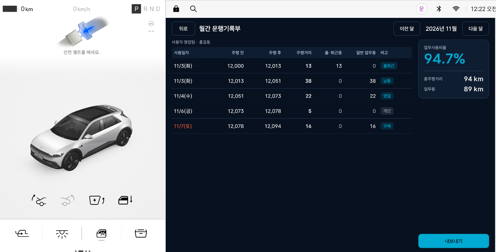
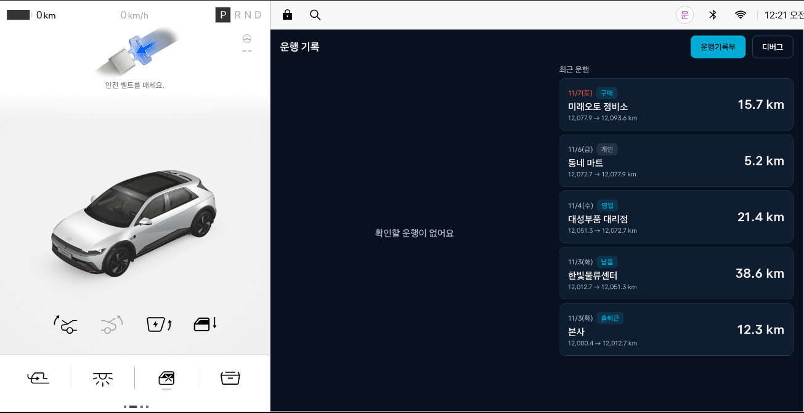
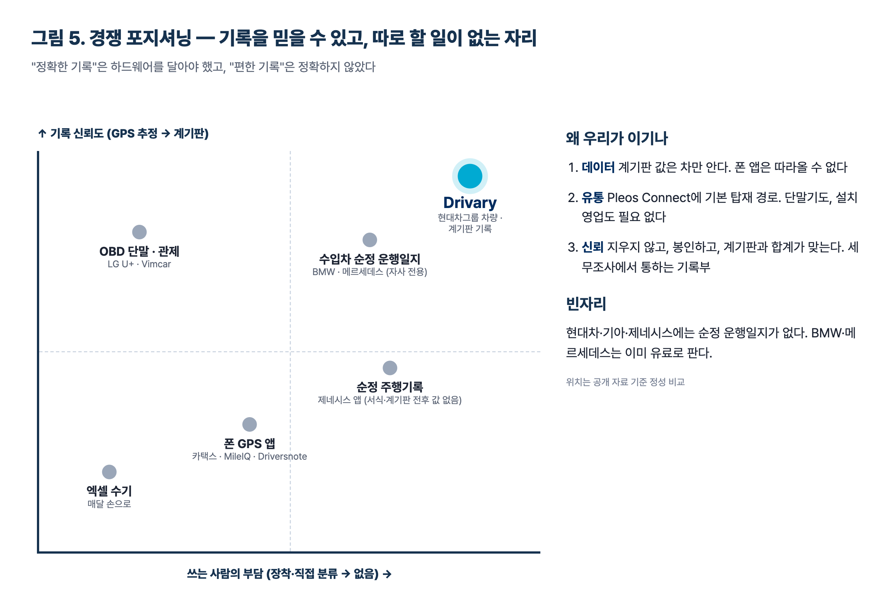
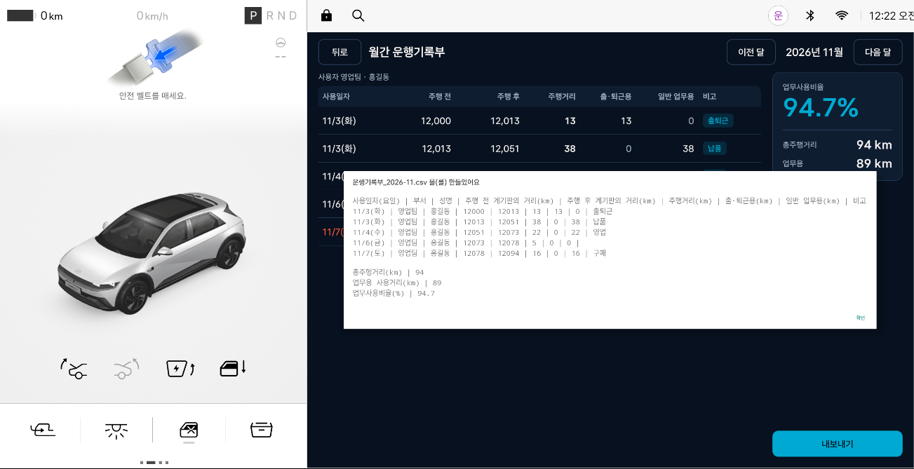

# Drivary (운행비서)

**운전만 하면 국세청 운행기록부가 끝나는 Pleos Connect 차량용 앱.**


<sub>Pleos Connect 에뮬레이터 실제 화면. 기어·계기판 값으로 기록한 운행이 국세청 서식으로 정리된다.</sub>

> 현대자동차그룹 차량용 앱 개발 공모전 출품작 · 팀 앤더스

## 요약

1. **법인 운행기록부는 매달 손으로 고쳐지고, 국세청은 바로 그 조작을 겨냥하고 있다.** 한 법인차의 한 달 운행 중 31%가 주말·공휴일이었고, 대표는 이를 엑셀에서 지워 왔다.
2. **Drivary는 차가 계기판 값으로 기록하고, 애매한 운행만 한 번 묻는다.** 차 한 대가 연 55만~116만 원을 아끼고, 요금은 그 5분의 1 이하다.
3. **현대차그룹에는 법인 고객을 지키는 무기다.** 1억 원 넘는 신차의 71%가 법인 소유이고, 경쟁 상대인 BMW·메르세데스는 순정 운행일지를 이미 팔고 있다.

---

## 1. 운행기록부는 매달 손으로 고쳐지고, 그 기록은 믿을 수 없다

| 근거 | |
|---|---|
| **31%** | 한 법인차의 한 달 운행 103건 중 20건(631km)이 빨간날 운행. 대표는 이를 엑셀에서 한 줄씩 지운 뒤 세무사에게 보냈다 (2026.11 인터뷰) |
| **1,500만 원** | 운행기록부가 없으면 연 1,500만 원까지만 비용 인정 (법인세법 시행령 제50조의2) |
| **19개 법인 · 90대** | 2026년 5월 국세청 고가 법인차 세무조사. 주요 수법으로 운행기록부 조작을 꼽았다 |

지우면 총주행거리가 계기판과 어긋나고, 업무사용비율이 부풀려진다. 문제는 기록이 없는 게 아니라 **마지막 수작업과 믿을 수 없는 기록부**다.

## 2. 차가 쓰고, 애매한 것만 묻는다. 운전자가 누르는 건 주말 운행 한 번뿐

| | |
|---|---|
| **차가 기록한다** | 기어가 P에서 빠지면 시작, 다시 P에서 멈추면 끝. 그때의 계기판 값을 서식에 그대로 적는다 |
| **확실한 건 묻지 않는다** | 평일, 등록한 업무 장소면 그 장소의 업무 목적으로 자동 분류 |
| **애매한 것만 한 번** | 빨간날·처음 가는 곳만 "○○에 영업하러 방문하셨나요?" 개인 운행도 지우지 않는다 |
| **월말엔 서식 그대로** | 국세청 운행기록부 칸 순서대로 CSV. 총주행거리는 언제나 계기판과 맞는다 |



## 3. 핵심 증빙인 계기판 값은 차만 안다. 그래서 차량 앱이어야 한다



| | 폰 GPS 앱 | OBD 단말·관제 | 수입차 순정 | **Drivary** |
|---|---|---|---|---|
| 거리 | GPS 추정 | 계기판 | 계기판 | **계기판** |
| 설치 | 앱 | 하드웨어 장착 | 기본 | **기본 탑재 경로** |
| 분류 | 운행마다 직접 | 직접 | 직접 | **애매한 것만 한 번** |
| 대상 | 모든 차 | 모든 차 | 자사 전용 | **현대차·기아·제네시스** |

## 4. 2026년, 규제·데이터·경쟁 세 가지가 처음 동시에 맞물렸다

| | 무엇이 바뀌었나 | 의미 |
|---|---|---|
| **규제** | 2024년 연두색 법인 번호판, 2026년 5월 국세청 법인차 세무조사 | 기록부는 이제 쓰는 것보다 **믿을 수 있는 것**이 중요하다 |
| **데이터** | 2026년 Pleos Connect 출시, 외부 개발자용 Pleos SDK | 외부 개발자가 기어·계기판 값으로 차 안 앱을 만들 수 있게 됐다. 폰 앱은 여전히 못 한다 |
| **경쟁 공백** | 현대차·기아·제네시스에는 순정 운행일지가 없다 | 독일 3사는 이미 판다. 먼저 채우는 쪽이 법인 고객을 가져간다 |

## 5. 순정으로 탑재하면 연 59억 원. 앱 마켓 단독의 약 27배다


| | 대상 | 연 매출 |
|---|---|---|
| **TAM** | 국내 법인 명의 승용차 276만 대 | 약 3,280억 원 |
| **SAM** | 2030년 Pleos 탑재 법인차 약 50만 대 (가정) | 약 590억 원 |
| **SOM** | 현대차 순정 옵션으로 SAM의 10% (가정) | **약 59억 원** |
| 비교 | 앱 마켓 단독, 3년차 MAU 1.3만 | 약 2.2억 원 |

개인사업자 차량과 해외는 넣지 않은 보수적 추정이다. 독일만 해도 업무용 승용차가 515만 대이고, 신차의 65%가 업무용으로 등록된다.

## 6. 고객은 내는 돈의 5~10배를 아끼고, 하드웨어 원가는 0원이다

**고객 경제성** (연 차량 비용 2,400만 원, 업무사용비율 88%인 법인차)

| 기록부 있음 | 기록부 없음 | 차이 × 법인세율 9~19% | Drivary 요금 |
|---|---|---|---|
| 2,112만 원 인정 | 1,500만 원 인정 | **연 55만~116만 원 절세** | 연 11만 8,800원 |

**누가, 왜, 어떻게**

| 누가 내나 | 왜 내나 | 어떻게 닿나 | 가격 |
|---|---|---|---|
| 법인 (대표·총무) | 비용 부인과 세무조사 위험, 여러 대·여러 운전자 관리 | 현대차 법인 판매 출고 시 순정 옵션 | 차량당 월 9,900원 |
| 개인사업자 | 월말 수작업, 절세 | Pleos 앱 마켓, **세무사 추천** | 월 4,900원 |
| 현대차그룹 | 법인 판매 방어, 반복 소프트웨어 매출 | 순정 탑재 (B2B2C) | 수익 배분 (협의) |

세무사 한 명은 여러 고객사의 장부를 맡는다. 세무사가 추천하면 고객 한 명을 데려오는 비용이 낮아진다. 단말기가 없으니 판매가 곧 이익이다.

## 7. 현대차그룹에게는 법인 고객을 지키는 무기다

1. **법인 고객이 고가차 수익의 중심이다.** 1억 원 넘는 신규 등록 차의 71%가 법인 소유다(최근 5년, 국토교통부 자료 2023년 보도). 제네시스는 2025년 국내 11만 8,395대가 팔렸고 G80은 40% 넘게 법인이 산다.
2. **1%만 지켜도 연 약 280억 원어치 판매다.** 제네시스 법인 고객의 1%(약 470대)가 이 기능 때문에 남으면 대당 6천만 원 기준 약 280억 원이다 (가정).
3. **맞붙는 상대는 이미 판다.** 법인 시장에서 제네시스와 경쟁하는 BMW·메르세데스는 순정 운행일지를 유료로 판다 (BMW 12개월 249유로).
4. **Pleos의 첫 B2B 킬러 앱이 된다.** 차 데이터로만 가능한 기능이라 폰 앱이 대신할 수 없고, 하드웨어 투자 없이 소프트웨어만으로 반복 매출을 만든다.
5. **유럽 진출의 열쇠다.** 독일은 운행일지가 없으면 매월 차량 정가의 1%가 과세 기준이 된다. Pleos Connect를 처음 다는 유럽 모델 IONIQ 3로 바로 들어갈 수 있다.

## 8. 세금이라는 강제 수요로 들어가, 업무 일지로 넓힌다

| 단계 | 시기 | 기능 |
|---|---|---|
| 1 | 출시 | 운행기록부 자동 작성 (지금) |
| 2 | 1년차 | 영업 방문 기록 (방문 후 차에서 음성 메모) |
| 3 | 1~2년차 | 법인 관리자 화면, 세무사 연동 |
| 4 | 2년차~ | 출장비·주유비 정산 |
| 5 | 3년차~ | 독일부터 해외, 나라별 서식만 추가 |

## 9. 리스크와 대응

| 리스크 | 대응 |
|---|---|
| 현대차가 직접 만들 수 있다 | 동작하는 앱, 고객 인터뷰, 서식 규칙을 이미 갖췄다. 입점·공동 개발로 출시 시간을 줄인다 |
| 세법·국세청 서식이 바뀐다 | 원시 기록을 그대로 두므로 서식 변환만 바꾸면 된다 |
| 일부 Pleos SDK가 아직 준비 중이다 | 핵심인 기어·계기판은 지금 SDK로 동작한다. 위치·음성은 공개 후 붙인다 |
| 위치·운행 기록은 민감하다 | 기록은 차 안에 두고, 운행기록부에 필요한 칸만 내보낸다 |

---

## 시연 (1분)

1. 홈 제목 **"운행 기록"을 길게 누르기** → 디버그 설정 → **이번 달 샘플 운행 5건 넣기**
2. 홈 미처리 카드: **업무 → 회의**
3. **운행기록부**: 총주행거리 94km · 업무용 89km · **업무사용비율 94.7%**
4. **내보내기** → `운행기록부_2026-11.csv`

직접 운행: Pleos 에뮬레이터 Virtual Console에서 기어 **D** → 몇 초 대기(시연 모드에서는 주행 중 계기판이 1초에 0.5km씩 저절로 오른다) → 기어 **P** → 10초 뒤 운행 1건 확정. 그 전에 D로 가면 같은 운행으로 이어진다.



## 구현 상태

| 기능 | 상태 |
|---|---|
| 기어·계기판으로 운행 기록 (Pleos Vehicle SDK) | ✅ 이 저장소 |
| 빨간날 판단, 자동 분류, 미처리 카드 | ✅ 이 저장소 |
| 월간 운행기록부, 국세청 서식 CSV | ✅ 이 저장소 |
| 내비 도착지(NaviHelper), 앱을 안 열어도 기록 | 프로토타입에서 검증 → 2차 PT까지 이식 |
| 기록 봉인(위·변조 검증), 세무사 자동 전송 | 설계 |

## 기술


| | |
|---|---|
| Pleos SDK | Vehicle SDK 2.3.2. 기어 `registerGearSelection`, 계기판 `getOdometer().getCurrentDistanceDriven` |
| 시연 모드 | Pleos 차량 서비스가 없으면 Fake 차량으로 자동 전환 |
| 구조 | 클린 아키텍처(data / domain / presentation), MVI, Hilt, Coroutines·Flow, Jetpack Compose |
| UI | 차량 가로 대화면, 현대자동차 CI 색 기반 다크 테마 |

**지키는 규칙**: 계기판 원본 값은 그대로 저장하고 반올림은 서식 출력 때만 한다. 주행거리는 반올림한 계기판 값끼리 빼서, 줄을 모두 더하면 계기판 차이와 같다. 개인 운행도 지우지 않는다. 미처리가 남아 있으면 내보내지 않는다.

## 실행 방법

```bash
git clone https://github.com/Endus-KR/Drivary-Android.git
```

Android Studio로 열고 Gradle Sync → **Automotive 또는 Pleos Connect 에뮬레이터**(가로)에서 ▶ Run. 차량 전용 앱이라 휴대폰 에뮬레이터에는 설치되지 않는다.

| 항목 | 값 |
|---|---|
| minSdk / targetSdk | 28 / 37 |
| JDK | 17 이상 |
| Kotlin / AGP | 2.4.20 / 9.5.1 |
| 테스트 화면 | 가로 2560×1440 |
| 권한 | `pleos.car.permission.CAR_DRIVE`, `CAR_POWERTRAIN` |

프로토타입 · 웹 체험판: [ddalkak-log.web.app](https://ddalkak-log.web.app)

---

팀 **앤더스** · 세법 내용은 요약이며 실제 신고는 세무사 확인이 필요하다. 절세액·시장 크기·매출은 공개 자료와 가정으로 계산한 추정치다.

<sub>출처: 법인세법 시행령 제50조의2 · 국세청 고가 법인차 세무조사 발표(2026.5.28) · 법인 명의 승용차(카이즈유, 2022.12) · 1억 원 초과 신규 등록 차 법인 비율(국토교통부) · 1억 원 이상 법인 신차(국토교통부, 2025) · 제네시스 판매(현대자동차 2025년 실적) · Pleos Connect 탑재 계획(현대자동차그룹, 2026.4) · 독일 업무용 승용차(업계 통계 정리, 2020·2021) · BMW Online-Fahrtenbuch 가격(2019년 기사)</sub>
