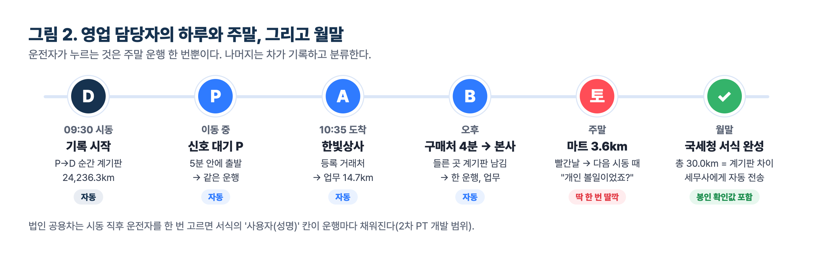
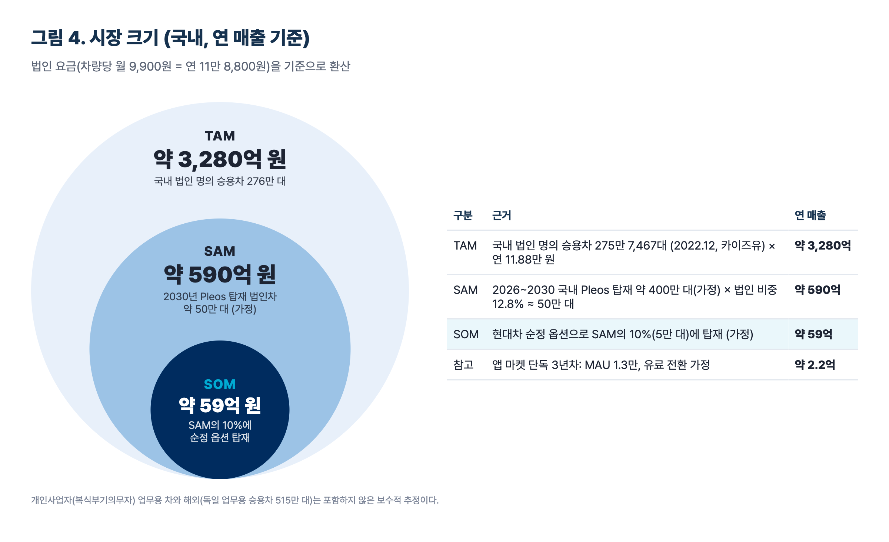
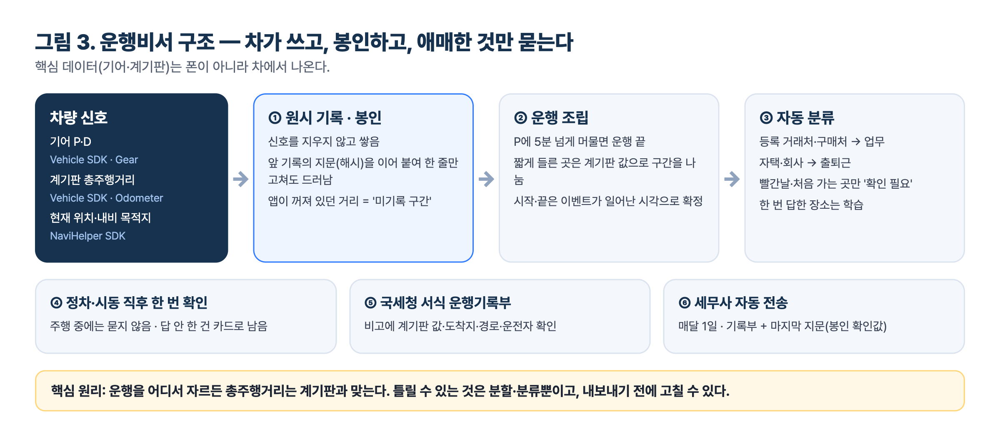

# Drivary (운행비서)

**운전만 하면 국세청 운행기록부가 끝나는 Pleos Connect 차량용 앱.**
차가 계기판 값으로 기록하고, 애매한 운행만 딱 한 번 묻는다.

| 31% | 연 55만~116만 원 | 2,000만 대 |
|:---:|:---:|:---:|
| 한 법인차의 한 달 운행 중<br>주말·공휴일 운행 비율 | 기록부 하나로 차 한 대가<br>아끼는 세금 (추정) | 2030년까지 Pleos Connect<br>탑재 목표 차량 |

> 현대자동차그룹 차량용 앱 개발 공모전 출품작 · 팀 앤더스

---

## 문제

법인차를 쓰는 한 사장님은 매달 말일, 차량 앱에서 주행기록을 엑셀로 받아 **주말·공휴일 운행을 한 줄씩 지운 뒤** 세무사에게 보낸다.

- 한 달 103건 중 **20건(631km)이 빨간날** 운행이었다.
- 지우면 총주행거리가 계기판과 어긋나고, 업무사용비율이 실제보다 높아 보인다.
- 2026년 5월, 국세청은 고가 법인차 19개 법인·90대를 세무조사하며 **운행기록부 조작**을 주요 수법으로 꼽았다.

기록은 이미 차에 있다. 마지막 수작업과 의심받는 기록부가 문제다.

## 해결

| | 하는 일 |
|---|---|
| **차가 기록한다** | 기어가 P에서 빠지면 시작, 다시 P에서 멈추면 끝. 그때의 계기판 값을 서식에 그대로 적는다 |
| **확실한 건 묻지 않는다** | 평일에 등록한 업무 장소로 간 운행은 그 장소의 업무 목적으로 자동 분류 |
| **애매한 것만 한 번 묻는다** | 빨간날·처음 가는 곳만 카드로 "○○에 영업하러 방문하셨나요?" 개인 운행도 지우지 않는다 |
| **월말엔 서식 그대로** | 국세청 업무용승용차 운행기록부 칸 순서대로 CSV를 만들어 세무사에게 보낸다 |


<sub>전체 설계 기준 그림. 구현 범위는 아래 '구현 상태' 참고.</sub>

## 왜 차량 앱이어야 하나

운행기록부의 핵심 증빙은 **계기판 값**이고, 그 값은 폰이 아니라 차만 안다.

| | 폰 GPS 앱 | OBD 단말기·관제 | **Drivary** |
|---|---|---|---|
| 거리 | GPS로 추정 | 계기판 | **계기판** |
| 운행 시작·끝 | 폰 움직임 감지 | 시동 | **기어 P↔D** |
| 폰을 두고 타면 | 기록 누락 | 기록 | **기록** |
| 설치 | 앱 | 하드웨어 장착 | **차에 기본 탑재** |
| 분류 | 운행마다 직접 | 직접 | **애매한 것만 한 번** |

---

## 사업성

### 고객이 버는 돈 > 내는 돈

업무용 차 관련 비용이 연 1,500만 원을 넘으면, 운행기록부가 없을 때 1,500만 원까지만 비용으로 인정된다(법인세법 시행령 제50조의2).

| 예시 (연 비용 2,400만 원, 업무사용비율 88%) | |
|---|---|
| 기록부 있음 | 2,112만 원 인정 |
| 기록부 없음 | 1,500만 원 인정 |
| 차이 × 법인세율 9~19% | **연 약 55만~116만 원 절세** |
| Drivary 법인 요금 | 연 11만 8,800원 (차량당 월 9,900원) |

**내는 돈의 5~10배를 아껴 준다.** 세무조사 때 "고치지 않은 기록"이라는 근거는 덤이다.

### 시장 크기



| | 대상 | 연 매출 |
|---|---|---|
| **TAM** | 국내 법인 명의 승용차 276만 대 | 약 3,280억 원 |
| **SAM** | 2030년 Pleos 탑재 법인차 약 50만 대 (가정) | 약 590억 원 |
| **SOM** | 현대차 순정 옵션으로 SAM의 10% | **약 59억 원** |

앱 마켓 단독이면 3년차 연 약 2.2억 원이다. **순정 탑재가 사업의 핵심**이고, 개인사업자 차량과 해외(독일 업무용 승용차 515만 대)는 아직 넣지 않은 보수적 추정이다.

### 경쟁


"정확한 기록"은 하드웨어를 달아야 했고, "편한 기록"은 정확하지 않았다. 현대차·기아·제네시스에는 순정 운행일지가 없다.

### 왜 지금인가

- **규제**: 2024년 연두색 법인 번호판, 2026년 국세청 법인차 세무조사. 기록부는 이제 쓰는 것보다 *믿을 수 있는 것*이 중요하다.
- **시장**: 1억 원 이상 법인 명의 신차만 2025년 3만 9,429대. 업무용 차를 쓰는 복식부기 개인사업자까지 더하면 훨씬 크다.
- **플랫폼**: Pleos Connect가 2026년 그랜저를 시작으로 2030년 2,000만 대에 탑재된다. 별도 단말기 없이 앱 하나로 닿는다.

### 수익 모델

| 요금제 | 가격 | 포함 |
|---|---|---|
| 무료 | 0원 | 차량 1대 기록·분류, 월간 서식 |
| 프로 | 월 4,900원 | 세무사 자동 전송, 5년 보관, 연간 리포트 |
| 법인 | 차량당 월 9,900원 | 여러 대·여러 운전자 통합 관리 |

앱 마켓 단독 3년차: MAU 1.3만 명, 연 약 2.2억 원(개인 0.8억 + 법인 1.4억, 전환율 가정). 관제 단말기(대당 월 1만 원대 + 장착)보다 싸고, 하드웨어 원가가 없다.

### 현대자동차그룹이 얻는 것

- BMW·메르세데스는 순정 운행일지를 **이미 유료로 판다**. 현대차그룹 차량에도 같은 무기가 생긴다.
- 법인 고객이 차를 바꿀 때 **현대차그룹에 머물 이유**가 되고, 법인 판매 상담에서 내세울 기능이 된다.
- Pleos 앱 마켓의 유료 구독 앱이 된다.
- **법인 고객 1%만 지켜도**: 제네시스는 2025년 국내 11만 8,395대, G80은 40% 넘게 법인이 산다. 그 1%면 연 약 470대, 약 280억 원어치 판매다 (대당 6천만 원 가정).

### 확장: 운행기록부에서 업무 일지로

| 단계 | 기능 |
|---|---|
| 1. 출시 | 운행기록부 자동 작성 (지금) |
| 2. 1년차 | 영업 방문 기록 (방문 후 차에서 음성 메모) |
| 3. 1~2년차 | 법인 관리자 화면, 세무사 연동 |
| 4. 2년차~ | 출장비·주유비 정산 |
| 5. 3년차~ | 해외 (독일: 운행일지 없으면 매월 차량 정가 1% 과세) |

세금 때문에 **안 쓸 수 없는** 기록부로 들어가서, 같은 운행 기록 위에 업무 기능을 쌓는다.

---

## 시연 (1분)

1. 앱 실행 → 홈 **디버그** → **이번 달 샘플 운행 5건 넣기**
2. 홈의 미처리 카드: **업무 → 회의** → 카드가 사라진다
3. **운행기록부**: 총주행거리 94km · 업무용 89km · **업무사용비율 94.7%**
4. **내보내기** → 공유 시트로 `운행기록부_2026-11.csv`

직접 운행해 보기: 디버그 설정에서 기어 **D** → 주행거리 **+3km** → 기어 **P** → 10초 뒤 운행 1건이 확정된다. 그 전에 다시 D로 가면 같은 운행으로 이어진다.

## 기술


<sub>전체 설계 기준 그림.</sub>

**구현 상태**

| 기능 | 상태 |
|---|---|
| 기어·계기판으로 운행 기록 (Pleos Vehicle SDK) | ✅ 이 저장소 |
| 빨간날 판단, 자동 분류, 미처리 카드 | ✅ 이 저장소 |
| 월간 운행기록부, 국세청 서식 CSV 공유 | ✅ 이 저장소 |
| 내비 도착지(NaviHelper), 앱을 안 열어도 기록(부팅 시 시작) | 프로토타입에서 검증 → 2차 PT까지 이식 |
| 기록 봉인(위·변조 검증), 세무사 자동 전송 | 설계 |

| | |
|---|---|
| Pleos SDK | Vehicle SDK 2.3.2. 기어 `registerGearSelection`, 계기판 `getOdometer().getCurrentDistanceDriven` |
| 시연 모드 | Pleos 차량 서비스가 없으면 Fake 차량으로 자동 전환 (기어·주행거리를 디버그 화면에서 조작) |
| 구조 | 클린 아키텍처(data / domain / presentation), MVI, Hilt, Coroutines·Flow, Jetpack Compose |
| UI | 차량 가로 대화면, 현대자동차 CI 색 기반 다크 테마 |

**핵심 규칙**

- 계기판 원본 값은 소수점 그대로 저장, 반올림은 서식 출력 때만
- 주행거리 = 반올림한 주행 후 값 − 반올림한 주행 전 값 → 줄을 더하면 계기판 차이와 정확히 같다
- 개인 운행도 지우지 않고 한 줄로 남긴다 → **총주행거리는 언제나 계기판과 맞는다**
- 미처리 운행이 남아 있으면 내보내기를 막는다
- P 이후 확정 대기: 시연 10초 (디버그에서 5·10·30초)

## 실행 방법

```bash
git clone https://github.com/Endus-KR/Drivary-Android.git
```

1. Android Studio로 열고 Gradle Sync
2. **Automotive 에뮬레이터**(가로) 또는 Pleos Connect 에뮬레이터에서 ▶ Run
   - 차량 전용 앱이라 휴대폰 에뮬레이터에는 설치되지 않는다
3. Pleos 에뮬레이터에서는 Virtual Console로 기어를 바꾼다

| 항목 | 값 |
|---|---|
| minSdk / targetSdk | 28 / 37 |
| JDK | 17 이상 |
| Kotlin / AGP | 2.4.20 / 9.5.1 |
| 테스트 화면 | 가로 2560×1440 |
| 권한 | `pleos.car.permission.CAR_DRIVE`, `CAR_POWERTRAIN` |

## 관련 자료

- 프로토타입 · 웹 체험판: [ddalkak-log.web.app](https://ddalkak-log.web.app) (설치 없이 브라우저에서 체험)

---

팀 **앤더스** · 세법 내용은 요약이며 실제 신고는 세무사 확인이 필요하다. 절세액·시장 크기·매출은 공개 자료와 가정으로 계산한 추정치다.

<sub>출처: 법인세법 시행령 제50조의2 · 국세청 고가 법인차 세무조사 발표(2026.5.28) · 법인 명의 승용차(카이즈유, 2022.12) · 1억 원 이상 법인 신차(국토교통부, 2025) · 제네시스 판매(현대자동차 2025년 실적) · Pleos Connect 탑재 계획(현대자동차그룹, 2026.4) · 독일 업무용 승용차(업계 통계 정리, 2020)</sub>
